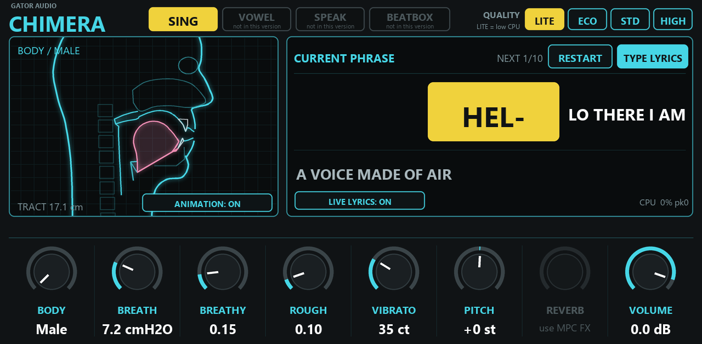
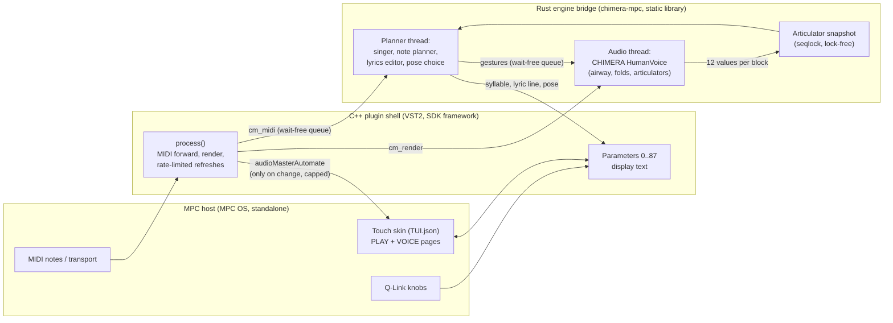

# CHIMERA Voice for Akai MPC

Standalone physical-modeling vocal synthesizer for Akai MPC hardware, featuring live lyrics,
animated vocal-tract articulation and optimized ARM audio processing.



<sub>Above: the PLAY page drawn on a PC from the plugin's real skin images and layout, with
substitute fonts and a new instance's text (`scripts/skin_preview.py`). It is not a capture from
the MPC. **Photo or video from the MPC One: [to be added](docs/media-checklist.md).**</sub>

CHIMERA Voice is an MPC instrument plugin that sings the words you type, one syllable per note,
with no samples: every sound comes from a simulated human airway (lungs, vocal folds, pharynx,
mouth and nose) shaped by moving articulators. It brings the open-source
[CHIMERA](https://github.com/jamesondh/chimera-vocal-synth) synthesis engine, written for the
browser and desktop, to the standalone MPC, where it runs on the device's own ARM processor with
a touchscreen interface and the hardware Q-Link knobs.

It is an independent, community project built with the
[MPC Plugin Builder SDK](https://github.com/inmusic-software/mpc-plugin-builder-sdk). It is not an
official Akai Professional or inMusic product, and the CHIMERA engine is the work of its own
author (see [Attribution](#attribution)).

**Status:** version 1.3.3-rc1, hardware-tested on an original first-generation MPC One.
Download it from the [Releases](../../releases) page.

## Features

- **Physically modeled singing.** CHIMERA's airway simulation and phonetic planner, with three
  bodies (male, female, child) and controls for breath pressure, breathiness, fold tension,
  roughness, vibrato and more.
- **Typed lyrics, sung syllable by syllable.** An on-screen keyboard over the PLAY page; each
  note sings the next syllable (English through the CMU pronouncing dictionary; also pinyin,
  Korean and Russian through CHIMERA's front ends). Up to 4,000 characters, saved in the project.
- **Live lyric highlighting.** The lyric line shows the syllable actually being sung, from the
  singer's own state, refreshed at most 5 times a second.
- **Articulator-driven anatomical animation.** The head on the PLAY page shows the pose nearest
  to what the voice's tongue, jaw, lips and velum are doing, about 12 times a second.
- **Low-CPU Lite quality.** A cheaper airway model (simulated at 3/4 rate, resampled) for the
  first-generation MPC One, beside Eco, Std and High.
- **Custom touchscreen interface and Q-Links.** Two pages (PLAY and VOICE), a working quality
  selector, and the eight performance controls on the Q-Link knobs.
- **ARM32 and ARM64 builds** for the MPC range, plus a native build for desktop testing.
- **Save-state and preset compatibility.** Parameters are only ever appended; projects from
  earlier versions load with their settings and lyrics.

## ## Engineering highlights

CHIMERA Voice required adapting a computationally intensive physical-modeling synthesizer to the hardware, performance constraints, and interface limitations of a standalone Akai MPC. The following engineering challenges shaped the project. See [Development History](docs/development-history.md) and [Architecture](docs/architecture.md) for technical details.

- **Optimizing physical modeling for embedded ARM hardware.** CHIMERA performs computationally intensive vocal-tract simulations at audio rates. Performance optimizations reduced expensive per-sample mathematical operations, including approximately 124 divisions and square roots to 5 in a representative test. Geometry-search optimizations preserved numerical accuracy, while a dedicated Lite quality mode reduced processing requirements by approximately 35% compared with Eco in desktop benchmarks. On the original MPC One, Lite typically peaks around 50% on the device's CPU meter.

- **Protecting real-time audio processing.** Computationally expensive operations are kept outside the audio callback. Note planning runs on a separate thread, with wait-free queues communicating events to the audio engine. Voice rebuilding also occurs outside the audio thread. Automated tests verify zero heap allocations during audio rendering.

- **Efficient host UI synchronization.** The MPC's display system requires careful management of host notifications. Early implementations updated multiple interface values on each MIDI note. The final architecture separates visual updates from audio rendering, using event-driven notifications and rate-limited lyric highlighting at up to 5 updates per second. Automated tests verify that host UI notifications are not issued from the audio callback.

- **Anatomical animation within a constrained rendering system.** The MPC skin framework cannot dynamically render or interpolate vocal-tract geometry. To reproduce CHIMERA's original visualization, the project captures real articulator states, generates 32 representative anatomical poses per voice, and selects poses using lock-free articulation snapshots. The resulting tongue, jaw, lip, and soft-palate animation follows the synthesized voice at a maximum of approximately 12.5 pose changes per second.

- **Hardware-driven debugging and regression testing.** Physical MPC testing exposed undocumented skin behaviors, including unconditional rendering of certain UI elements and limited text-label capacity. These findings informed the touchscreen keyboard, lyric editor, and navigation design. Regression tests now validate the generated interface against these hardware-specific constraints.

- **Reproducible builds and verified releases.** Hardware-tested versions are preserved using Git tags, SHA-256 checksums, and archived release packages. A clean checkout of the public repository retrieves pinned upstream dependencies and reproduces the tested ARM binaries, skin, and image assets. Automated Rust tests, plugin validation, host simulation, and physical MPC testing support release verification.

## Architecture



- **Rust (`engine/chimera-mpc`)**: everything about the voice. It covers the audio-thread
  renderer, the planner thread (the live singing controller, CHIMERA's note planners, lyrics and
  the typed-lyrics editor), the animation's articulator snapshot and pose matching, and a C ABI
  (`cm_*`).
- **C++ (`plugin/src/ChimeraVoice.cpp`)**: a thin VST2 shell on the MPC SDK framework. It handles
  parameters and their display text, saving the state, and the rate-limited host refreshes.
- **Skin (`plugin/skins_post.py`, `plugin/play_page.py`, `plugin/skin/`)**: generated at build
  time. It holds the PLAY page, the keyboard panel, the pose-atlas images and the Q-Link map.

## Hardware performance

Readings below come from the CPU display on an original first-generation MPC One, observed by the
developer. They are not lab benchmarks.

| Quality | Peak CPU on the MPC One | Practical? |
|---|---|---|
| Lite | about 50% | yes (recommended) |
| Eco | about 89% at times | usable, little headroom |
| Std | about 118-125% | no |
| High | about 167-200% | no |

The animation (1.3.3-rc1) and live lyrics (1.3.2-rc1) caused no noticeable added latency,
stuttering, underruns or CPU cost in hardware testing. PC measurements (render time per audio
block, host calls per second) are in [docs/hardware-performance.md](docs/hardware-performance.md),
kept apart from the MPC readings.

## Installation

1. Use an Akai MPC running **MPC OS 3.10.1 or later**. Only the first-generation MPC One has been
   tested.
2. On the MPC, enable plugins: **Preferences → Enhancements (Beta) → Enable Enhancements** and
   **External Plugin Support**.
3. Download `chimera-voice-1.3.3-rc1-mpc.zip` from [Releases](../../releases). Check its SHA-256:
   `78e1fcc982e0525fa45019b0c783ee9afb487ecfe660986c5598e38b22de4f79`.
4. Unzip it. Copy the folder **`Gator Audio - VST - Chimera Voice`** into a folder named
   **`VST2 Plugins`** at the root of an MPC drive (SD card or USB), then restart the MPC.
5. Load **Chimera Voice** (vendor "Gator Audio", the plugin's maker name) on a plugin track and
   play notes. Choose **LITE** on an MPC One.

The zip also contains `INSTALL.txt`. [docs/troubleshooting.md](docs/troubleshooting.md) covers a
plugin that doesn't appear, crackles or high CPU.

## Building from source

```sh
git clone --recurse-submodules https://github.com/JPalmtrees/chimera-voice-mpc.git
cd chimera-voice-mpc
rustup target add armv7-unknown-linux-gnueabihf aarch64-unknown-linux-gnu
python scripts/build.py --package   # engine for ARM32/ARM64/native, then the plugin and zip
python scripts/test.py              # Rust, skin, compiled-plugin and host-simulator tests
```

You need Python 3.10+, Git and Rust. On Windows you also need the `x86_64-pc-windows-gnu` target
for the native test build. The SDK installs its C++ toolchain (zig) through pip on first use.
The build was verified from a clean clone on Windows. [docs/building.md](docs/building.md) has
the details, the output paths and the platform limits.

## Testing

- **Rust:** unit and integration tests of the engine bridge. They cover syllable timing, lyrics
  and the editor, quality modes, zero allocation while rendering, display tracking, the
  articulator snapshot and articulation facts ("saw" opens the jaw more than "see").
- **Generated skin:** a test of the packaged `TUI.json` against the rules learned on the MPC.
- **Compiled plugin:** two VST2 harnesses.
  - `keyboard_test`: parameters, typing, Done/Cancel, saved state from older versions, long
    UTF-8 lyrics.
  - `realtime_test`: the syllables sung, the host calls made from the audio callback and their
    rate, render time per block.
- **SDK host simulator:** VST2 conformance, state round trip, MIDI and silence.
- **On hardware:** each release candidate is played on the MPC One before it is called
  hardware-tested.

See [docs/testing.md](docs/testing.md).

## Limitations

- Hardware-validated on the **first-generation MPC One** only. Other MPC models and firmware
  versions are untested (the ARM64 build is untested on hardware).
- The animation shows the nearest of **32 pre-drawn poses** per body, at most 12.5 changes a
  second, with no blending. It is accurate but slightly jittery, and the larynx height is not
  shown.
- **VOWEL, SPEAK and BEATBOX** are shown on the PLAY page but are not implemented yet.
- There is one voice at a time (monophonic), and only ASCII can be typed on the keyboard.
- The released package's description still has the SDK template's text ("a 4-voice synth…
  Describe your plugin here."). This is cosmetic and left as tested; see
  [docs/known-issues.md](docs/known-issues.md).
- This is an independent project, not endorsed by Akai Professional or inMusic.

## Attribution

- **CHIMERA**, the physical-modeling vocal synthesizer, by Jameson Hodge (MIT):
  https://github.com/jamesondh/chimera-vocal-synth. The engine, airway, anatomy and phonetics
  are upstream work. This project adds the `chimera-mpc` crate and changes five engine files for
  performance ([patches/chimera-vocal-synth](patches/chimera-vocal-synth)).
- **MPC Plugin Builder SDK**, by inMusic Brands, Inc. (MIT):
  https://github.com/inmusic-software/mpc-plugin-builder-sdk. This covers the VST2 framework, build
  and packaging tools, skin generator and host simulator. This project adds two build hooks
  ([patches/mpc-plugin-builder-sdk](patches/mpc-plugin-builder-sdk)).
- The CMU Pronouncing Dictionary, the pinyin data and the Rust crates linked into the plugin are
  listed with their licenses in [THIRD_PARTY_NOTICES.md](THIRD_PARTY_NOTICES.md).

**How this was built.** This is an AI-assisted engineering project. The code was implemented
largely with an AI coding assistant (Claude, in Claude Code). It worked to the project owner's
requirements, constraints, priorities and decisions.

The owner did the following:

- defined each release's goals;
- chose the trade-offs, such as the stability-first defaults and never changing parameter
  numbers;
- reviewed the results;
- did all physical testing on the MPC One, including tracing one "stutter" to an external
  controller's arpeggiator.

The upstream engine and SDK are their authors' work. See
[docs/development-history.md](docs/development-history.md).

## Contributing

Bug reports from real hardware are the most valuable contribution. Include the MPC model,
firmware, quality mode and CPU readout (see [CONTRIBUTING.md](CONTRIBUTING.md)).

## License

MIT for this project's own files ([LICENSE](LICENSE)). The upstream projects and bundled data
keep their own licenses ([licenses/](licenses), [THIRD_PARTY_NOTICES.md](THIRD_PARTY_NOTICES.md)).
"MPC" and "Akai Professional" are trademarks of inMusic Brands, Inc.; "VST" is a trademark of
Steinberg Media Technologies GmbH.
