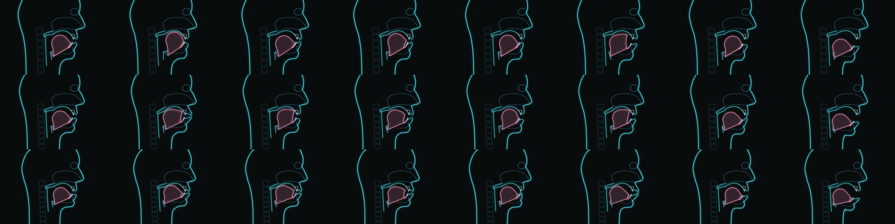

# Architecture

CHIMERA Voice is a VST2 instrument for the MPC's standalone OS. It has three layers:

- a thin C++ shell (`plugin/src/ChimeraVoice.cpp`);
- a Rust static library holding everything about the voice (`engine/chimera-mpc`, built against
  the upstream `chimera` crate);
- a touch skin generated at build time (`plugin/skins_post.py`, `plugin/play_page.py`).

## Threads and data flow

```mermaid
sequenceDiagram
  participant H as MPC host
  participant P as C++ process() (audio thread)
  participant A as Rust audio renderer
  participant W as Rust planner thread
  H->>P: MIDI note on, block of 128 frames
  P->>W: cm_midi → events queue (wait-free SPSC)
  W->>W: singer: next syllable → CHIMERA note planner → gestures
  W->>A: gestures queue (wait-free SPSC)
  P->>A: cm_render(out)
  A->>A: gestural score → articulators → tract geometry → airway + glottis
  A-->>W: articulator snapshot (seqlock, only while Animation is on)
  W->>W: display snapshot (syllable, lyric line); nearest head pose every 80 ms
  P->>P: versions changed? rate limits passed?
  P-->>H: audioMasterAutomate (Next, Before, After, Words, Upcoming / Tract)
  H->>P: effGetParamDisplay (UI thread) → cm_text
```

| Thread | Owner | Does | Must not |
|---|---|---|---|
| Audio | host → `process()` → `cm_render` | renders the voice, applies gestures and knob values, forwards MIDI, copies 12 articulator values per block (Animation on), sends the capped host refreshes | allocate, lock, do I/O, format text |
| Planner | Rust (`instrument.rs::Worker`) | the live singer, CHIMERA's note planners, lyrics and the typed-lyrics editor, voice rebuilds (Voice/Quality), display snapshot, pose choice | touch the audio state except through queues |
| Dictionary | Rust, once | loads the CMU dictionary at start-up; joined on close | outlive the plugin (a fast unload crashed before 1.3) |
| Host UI | host | asks for parameter display text (`formatValue` → `cm_text`), saves/loads state | |

The planner and audio threads exchange only two wait-free single-producer/single-consumer rings
(`ring.rs`) and atomics. A rebuilt voice is a boxed pointer sent to the audio thread and swapped
in there; the old one goes back to the planner to be freed. `tests/instrument.rs` counts heap
allocations during `render` and requires zero, including across a body and quality switch and
with the animation on.

## The C ABI (`engine/chimera-mpc/src/lib.rs`, `plugin/src/chimera_mpc.h`)

ABI version 7. Lifecycle: `cm_new`, `cm_free`. Audio thread: `cm_render`, `cm_midi`,
`cm_transport`. Any thread: `cm_set_param`, `cm_key` (on-screen keyboard), `cm_set_animation`.

Version counters (real-time safe):

- `cm_text_version`: the editor changed;
- `cm_jump_version`: a deliberate lyric jump, such as Done, restart or a project load;
- `cm_display_version`: the sung syllable or its context changed;
- `cm_anim_version`: the head pose changed.

Non-real-time: `cm_text(kind)` for display strings, and `cm_state_get`/`cm_state_set` for the
lyrics editor in the project chunk.

## Parameters

Parameter order is permanent: saved projects refer to it, so new parameters are only appended.

| Index | Parameters | Notes |
|---|---|---|
| 0-18 | Volume, Voice, Transpose, Fine, Bend Rng, Breath, Breathy, Vibrato, Vib Rate, Pressed, Bright, Rough, Ring, Lyrics, Start Syl, Restart, Play Sync, Vel Sens, Quality | shared with the Rust side (`P_*`). Quality values: Eco 0, Std 1, High 2, Lite 3 (Lite appended in 1.2) |
| 19-20 | CPU, Next | display |
| 21-73 | 53 keyboard keys | one toggle per key; each flip is one press (debounced 0.16 s) |
| 74-76 | Lyric Text, Source, Keyboard | editor status line, Typed/File, keyboard panel open |
| 77-80 | Before, After, Words, Head | lyric line, position; Head unused since 1.3.0-rc2 |
| 81-83 | Edit 1-3 | the draft as three lines of at most 30 bytes |
| 84-85 | Upcoming, Live Lyr | next lyric line; live highlighting on/off |
| 86-87 | Tract, Animation | head pose (32 frames); animation on/off (default off) |

## Host refreshes (why and how they are limited)

The MPC re-reads a parameter's display text when it redraws a page or when the plugin reports
that the value moved (`audioMasterAutomate`). The plugin has no editor window and no idle
callback; the host's own screen and knob traffic arrives on the audio thread. So the only
host-notification path available, and the one proven on the MPC, is from `process()`. Each
refresh moves the display parameter's value (a counter) and reports it. Text formatting happens
later, on the host's UI thread, when it asks for the display string.

| What | When | Calls | Cap |
|---|---|---|---|
| Keyboard status + 3 lines | a key changed the editor | 4 | user typing speed |
| Lyric line (Next, Before, After, Words, Upcoming) | Done, Restart, start syllable, project load, transport start | 5 | per action |
| Lyric line, live | the sung syllable changed (Live Lyrics on) | 5 | 1 per 0.2 s |
| Head pose (Tract) | the chosen pose changed (Animation on) | 1 | 1 per 0.08 s |

1.3.0-rc1 reported six values at every note, with no limit. That build stuttered during
hardware testing, although an external arpeggiator was later found to be the cause. The design
above bounds the worst case at about 37 calls a second with every feature on, and makes each
feature switchable.

## Live lyrics

`Singer::focus()` (`singer.rs`) returns the syllable the sounding note sang. A melisma mark keeps
its parent syllable, and a legato glide back to a held key keeps that key's syllable. In
silence it returns the next syllable. The planner publishes the text and context after every
note event (`instrument.rs::publish`). Every string fits the host's 31-byte display limit on a
UTF-8 character boundary.

## Anatomical animation

The original CHIMERA web app streams the voice's 17 articulator values to the browser, which
rebuilds the midsagittal anatomy (`HumanVocalTract::compute_new`) and draws vector outlines at 60
fps. MPC skins can only show film-strip frames, so the animation is split in two.

- **Offline:** `engine/chimera-mpc/examples/anim_poses.rs` sings a corpus through the plugin's
  own `Instrument` at Lite quality, without real time.
  - It records the 12 visible articulators after every 128-sample block (37,450 samples per
    body). These are jaw; tongue body x and y, tip x and y, curl and root; lip aperture,
    protrusion, width and labiodental contact; and velum.
  - It clusters them with k-means into 32 poses per body. Each articulator is scaled by its
    spread, and pose 0 is fixed at rest. Transitions are included because they were recorded.
  - Mean scaled error by pose count was 1.05 at 16, 0.71 at 24, 0.62 at 32 and 0.54 at 48 (male).
    32 was chosen for image memory.
  - `plugin/skin/make_assets.py --anim` draws every pose with CHIMERA's anatomy. It splits the
    drawings into a still base and a film strip of only the region that moves (about 190 x 186
    px), checking that outside it every pose matches rest to within 2/255. The three heads decode
    to about 14 MB.
- **Live:**
  - The audio thread writes the 12 values into `anim::ArticSnapshot` (a seqlock over atomics: 14
    relaxed stores, single writer) after each block, only while Animation is on.
  - Every 80 ms the planner reads the snapshot (retrying if torn) and finds the nearest pose for
    the current body. It publishes the pose number only if it changed.
  - The shell moves `Tract` to it, at most every 0.08 s.

Not shown: the larynx height and the other articulators outside the 12 (drawn at rest). Poses
are not blended.



## The skin and its hardware rules

The SDK's generator builds the VOICE page from `plugin/ui.json`. `skins_post.py` then adds the
PLAY page (`play_page.py`) and the keyboard panel, and rewrites the Q-Link map. Hardware testing
found four behaviours that the SDK documentation did not make clear. Each is now a check in
`plugin/tests/skin_test.py`.

1. An entry with `showWhenDataModelInvalid: "Show"` is always drawn. The keyboard panel was
   drawn over PLAY in 1.3.0-rc1 because of this. Conditional items use `"Hide"` with their own
   handle valid only when shown.
2. A `Text` label bound to `Invalid` is not drawn. The DONE and BACK keys were blank in
   1.3.0-rc2. Every caption is now bound to a real parameter.
3. A label drawn over a button takes its touches. The Quality buttons did nothing in 1.3.0-rc2.
   Buttons are now drawn last, with captions underneath.
4. Parameter display text reaches the host cut to 31 bytes (`kStr` in the SDK framework). The
   one-line keyboard draft lost its cursor after about 23 characters. It is now three lines of at
   most 30 bytes.

The keyboard panel also sets `hideQLinkBounds` (component version 4). Without it, the knob row's
Q-Link highlight showed through over SHIFT and SPACE.

## Repository layout and the build

| Path | Content |
|---|---|
| `engine/chimera-mpc/` | the Rust bridge crate (new code) |
| `plugin/` | the MPC plugin project: C++ shell, skin generator, assets, tests |
| `patches/chimera-vocal-synth/` | engine changes against upstream `eeb0c19`: the performance work in five engine files and the workspace member |
| `patches/mpc-plugin-builder-sdk/` | SDK changes against upstream `a5949cf`: two hooks in `tools/build.py` (a project's `link.json` adds static libraries to the link; a project's `skins_post.py` edits the generated skin) and `restoringState()` in `framework/mpc_plugin.h` (tells a state restore from a user gesture, so restoring a project never types keys) |
| `external/` | the two upstreams as submodules at those commits |
| `scripts/` | bootstrap, build, test, audit, skin preview |

`scripts/bootstrap.py` applies the patches and copies `engine/chimera-mpc` and `plugin/` into the
upstream trees, at the paths they had in the release build. The cargo workspace, its release
profile (`opt-level 3`, fat LTO, one codegen unit, `panic = abort`) and every relative path are
therefore the same as in the tested build.
